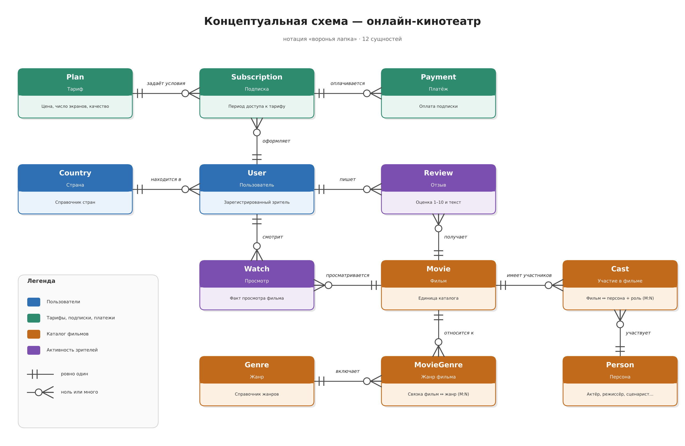

# Онлайн-кинотеатр

Учебный проект по базам данных (3 семестр): реляционная база данных онлайн-кинотеатра на PostgreSQL.

## Команда

- Ташбулатов Самат Вильданович, ТОП 202Б
- Кагарманов Аяз Вильданович, ТОП 202Б

## Описание предметной области

Онлайн-кинотеатр — стриминговый сервис, в котором пользователи смотрят фильмы по платной подписке.

- Пользователь регистрируется, указывает страну и оформляет **подписку** на один из **тарифов**. Тарифы различаются ценой, числом одновременных экранов и максимальным качеством видео (SD, HD, FHD, 4K).
- Подписка оплачивается через **платежи** (карта, PayPal, СБП, Apple Pay, Google Pay).
- Каталог состоит из **фильмов**. У каждого фильма есть жанры (один фильм может относиться к нескольким жанрам) и съёмочная группа: актёры, режиссёры, сценаристы, продюсеры и композиторы. Один человек может участвовать в разных фильмах и в разных ролях.
- Пользователи **смотрят** фильмы (система запоминает, сколько просмотрено и досмотрен ли фильм) и оставляют **отзывы** с оценкой от 1 до 10.

## Назначение базы данных

База хранит данные сервиса и позволяет по ним получать аналитику и отвечать на практические вопросы, например:

- какие фильмы самые высокооценённые и популярные, в том числе по жанрам;
- какая выручка у каждого тарифа и какова её доля в общей;
- какие подписки активны, истекли или отменены, и кто платит успешно;
- что смотрит каждый пользователь и какие фильмы он досматривает до конца;
- в каких фильмах и в каких ролях снимался тот или иной человек.

## Основные таблицы

В базе 12 таблиц:

| Таблица | Описание |
|---|---|
| `country` | Справочник стран |
| `users` | Пользователи сервиса |
| `plan` | Тарифы: цена, число экранов, максимальное качество |
| `subscription` | Подписки пользователей на тарифы (период действия, статус) |
| `payment` | Платежи по подпискам |
| `movie` | Фильмы каталога |
| `genre` | Справочник жанров |
| `movie_genre` | Связь «фильм — жанр» (многие ко многим) |
| `person` | Персоны: актёры, режиссёры и др. |
| `movie_cast` | Связь «фильм — персона» с указанием роли (многие ко многим) |
| `watch` | Факты просмотров фильмов пользователями |
| `review` | Отзывы и оценки пользователей |

Каждая таблица заполнена не менее чем 50 строками.

## Структура репозитория

```
.
├── schemas/        # концептуальная, логическая и физическая схемы БД
├── data/           # CSV-файлы с данными для загрузки
├── base_part/      # SQL-скрипты обязательной части
│   ├── 00_create_database.sql   # создание базы данных cinema
│   ├── 01_create_tables.sql     # создание таблиц и ограничений
│   ├── 02_load_data.sql         # загрузка данных из CSV
│   └── 03_select_queries.sql    # 15 SELECT-запросов
├── advanced_part/  # дополнительные этапы
└── README.md
```

## Запуск SQL-скриптов

**Требования:** установленный PostgreSQL и клиент `psql`.

Все команды выполняются **из корня репозитория**: скрипт загрузки обращается к CSV по относительным путям `data/*.csv`. Если нужен другой пользователь или хост, добавьте в команды `psql` ключи `-U <пользователь>` и `-h <хост>`.

1. Создайте базу данных `cinema`:

   ```bash
   psql -U postgres -f base_part/00_create_database.sql
   ```

   Если база `cinema` уже есть, сначала удалите её: `DROP DATABASE cinema;`.

2. Создайте таблицы (скрипт предварительно удаляет одноимённые таблицы, поэтому его можно запускать повторно):

   ```bash
   psql -U postgres -d cinema -f base_part/01_create_tables.sql
   ```

3. Загрузите данные из CSV (после загрузки скрипт синхронизирует счётчики идентификаторов и выводит число строк в каждой таблице):

   ```bash
   psql -U postgres -d cinema -f base_part/02_load_data.sql
   ```

4. Выполните SELECT-запросы:

   ```bash
   psql -U postgres -d cinema -f base_part/03_select_queries.sql
   ```

То же самое можно выполнить из интерактивного `psql`, находясь в корне репозитория:

```sql
\i base_part/00_create_database.sql
\i base_part/01_create_tables.sql
\i base_part/02_load_data.sql
\i base_part/03_select_queries.sql
```

## Схемы базы данных

Схемы лежат в папке `schemas/`: концептуальная (нотация «воронья лапка», 12 сущностей), логическая и физическая.


